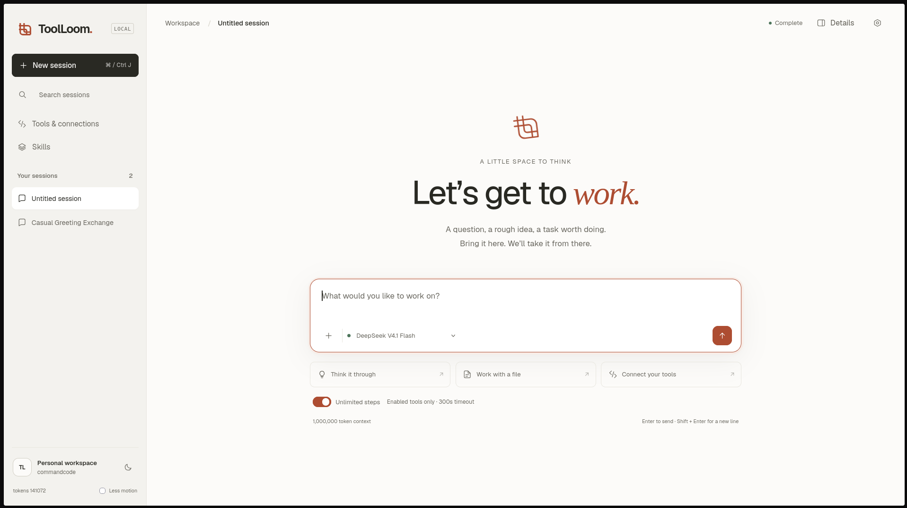

# ToolLoom

ToolLoom is a local-first, single-user AI agent runtime. The backend owns the
agent loop: it builds context, calls the model, streams the reply, executes the
tools the model requests, feeds the results back, and repeats until the model
finishes or a budget is reached. Conversations, tool calls, results, task state
and token usage are stored in a local SQLite database.

The browser is a thin client over REST and server-sent events. It never talks to
a model or an MCP server directly, and it never holds a credential. ToolLoom
binds to `127.0.0.1` by default and runs with no hosted ToolLoom backend, no
account and no telemetry.



## Features

- **Backend-owned agent loop** with streaming responses, stop reasons, usage and
  resumable runs, plus configurable step, tool-call, output and time budgets.
- **Optional background runs.** Keep a run working after disconnect, attach to its
  saved event stream, cancel it explicitly, or queue a new direction between model
  requests. Backend restarts interrupt work; Continue resumes from saved state.
- **Provider-neutral model contract.** The included adapter targets the
  [Command Code Provider API](https://api.commandcode.ai/provider/v1) using
  OpenAI-compatible or Anthropic-compatible wire styles. A deterministic
  `fake` provider runs the app offline with no key or network.
- **One tool contract, several sources.** Remote MCP servers (Streamable HTTP,
  legacy SSE, and operator-configured stdio), built-in local tools, and generated
  capabilities all use the same catalogue, JSON-schema validation, risk level,
  approval gate and executor.
- **Per-conversation workspaces.** The agent can read, write, grep and delete
  files in its own directory. Files can be uploaded from the UI, and one file or
  the whole workspace can be downloaded.
- **Durable task state.** A task holds the objective and a versioned plan; a run
  records one attempt; a tool attempt records one dispatch and its outcome.
  Interrupted work can be resumed with evidence of what already happened.
- **Context management.** Long conversations are compacted and reduced to fit
  the selected model's context window, with the objective and plan preserved.
- **MCP and skills.** Register MCP servers from the UI, and install `SKILL.md`
  bundles from a zip or Markdown file. New tools and skills start disabled.
- **Tool Foundry.** Turn a reusable script into a reviewed, tested capability
  with a generated CLI, install it, and approve it for later conversations.
- **Encrypted local secrets.** Store values in an encrypted vault and reference
  them as `${secrets.NAME}` in MCP headers or environment values.
- **Local UI.** A vanilla HTML/CSS/JS interface with light and dark themes,
  conversation search, task/run inspection, tool activity and workspace browsing.

## Requirements

- Python 3.11 or newer (3.12 recommended)
- [uv](https://docs.astral.sh/uv/) for dependency management
- SQLite (bundled with Python)
- Optional: Node.js and Playwright for the browser smoke tests

## Quick start

From the repository root:

```bash
uv python install 3.12
uv sync

cp .env.example .env
# Set COMMANDCODE_API_KEY in .env

uv run uvicorn backend.main:create_app --factory --host 127.0.0.1 --port 8000
```

Open <http://127.0.0.1:8000>.

To run without a key or network, set `LLM_PROVIDER=fake` in `.env`. The fake
provider is deterministic and intended for local development and tests.

## Configuration

Configuration is environment-driven. Copy `.env.example` to `.env`; every
setting is documented there. The most commonly changed values are:

| Variable | Default | Purpose |
| --- | --- | --- |
| `LLM_PROVIDER` | `commandcode` | `commandcode` for the real provider, `fake` for offline use |
| `COMMANDCODE_API_KEY` | — | Provider key. Server-side only; never sent to the browser |
| `COMMANDCODE_BASE_URL` | `https://api.commandcode.ai/provider/v1` | Provider endpoint |
| `COMMANDCODE_MODEL` | `deepseek/deepseek-v4-flash` | Default model id |
| `COMMANDCODE_API_STYLE` | `auto` | `openai`, `anthropic`, or `auto`; known Claude models always use `/messages` |
| `MODEL_MAX_OUTPUT_TOKENS` | auto | Per-turn output cap; blank derives it from the context window |
| `MODEL_CONTEXT_WINDOW` | auto | Optional local ceiling; blank uses provider metadata |
| `TOOLLOOM_MAX_ITERATIONS` | `100` | Model turns per run |
| `TOOLLOOM_MAX_TOOL_CALLS` | `300` | Tool calls per run |
| `TOOLLOOM_MAX_OUTPUT_CONTINUATIONS` | `3` | Automatic continuation of truncated replies |
| `TOOLLOOM_RUN_TIMEOUT_SECONDS` | `1800` | Deadline for one agent run (max 7200) |
| `TOOLLOOM_HOST` / `TOOLLOOM_PORT` | `127.0.0.1` / `8000` | Bind address |
| `TOOLLOOM_DATA_DIR` | `.local` | SQLite database, vault key, workspaces and installed tools |
| `TOOLLOOM_DB_BUSY_TIMEOUT_SECONDS` | `1` | SQLite lock wait before returning a busy error |
| `TOOLLOOM_ALLOW_PYTHON` | `0` | Enables the `python` tool |
| `TOOLLOOM_ALLOW_SHELL` | `0` | Enables the `shell` tool |
| `TOOLLOOM_ALLOW_FOUNDRY` | `0` | Enables the Tool Foundry tools |
| `TOOLLOOM_ALLOW_STDIO` | `0` | Allows operator-configured stdio MCP servers |
| `TOOLLOOM_SEARCH_PROVIDER` | `duckduckgo` | `duckduckgo`, `wikipedia`, or `searxng` |
| `TOOLLOOM_AUTO_TITLES` | `1` | Generate conversation titles with the selected model |

## Using ToolLoom

### Conversations

Create a conversation, choose a model in the composer, and send a message. The
backend streams progress and tool activity over SSE. Reloading the page restores
the transcript, including tool inputs, results and stop reasons.

Each conversation has its own workspace under
`TOOLLOOM_DATA_DIR/workspaces/<conversation-id>/`. Attach files with the
paperclip; download individual files or the whole workspace from the details
panel.

### Tools and permissions

Open **Settings → MCP** to manage servers and tools.

- Every discovered tool starts **disabled**.
- Tools marked high risk also require explicit **approval**.
- Enabling a server is a master switch; its tools still need their own toggles.
- The model cannot enable or approve a tool itself.

The built-in `sandbox` server includes:

| Tool | Purpose |
| --- | --- |
| `fs_read`, `fs_write`, `fs_edit`, `fs_list`, `fs_grep`, `fs_delete` | Workspace files; guarded exact edits |
| `repo_instructions` | Workspace `AGENTS.md` / `CLAUDE.md` discovery, root to target directory |
| `plan_read`, `plan_write` | Durable task objective and plan |
| `http_fetch` | Outbound HTTP(S) with private/loopback hosts refused |
| `web_search` | Keyless web search (DuckDuckGo, Wikipedia or SearXNG) |
| `python` | Python subprocess (opt-in, high risk) |
| `shell` | Shell command execution (opt-in, high risk) |
| `skill_list`, `skill_read` | Read enabled skills |
| `foundry_scaffold`, `foundry_validate`, `foundry_install` | Tool Foundry |

Installed capabilities appear under the runtime-owned `generated` server.

### MCP servers

Add HTTP, SSE or operator-configured stdio servers in Settings. Imports use the
common `mcpServers` JSON shape, are validated as a whole before changing
anything, and never grant permissions from the imported file. Removed or
changed connections disable their tools and revoke earlier approvals.

Stdio servers require `TOOLLOOM_ALLOW_STDIO=1` and an explicit command and
argument list. The model cannot create or edit a stdio command.

### Skills

Install a `SKILL.md` bundle from a `.zip`, `.md` or `.markdown` file under
**Settings → Skills**. Installed skills start disabled. Enabled skills are
listed in the model's prompt and can be read with `skill_list` / `skill_read`.

### Tool Foundry

Tool Foundry turns a script into a reusable capability:

1. **Scaffold** a package with `foundry_scaffold`. It writes a manifest, a CLI
   whose flags match the declared schema, and tests.
2. **Validate** it with `foundry_validate`; the generated tests must run and pass.
3. **Install** it with `foundry_install`. The package is copied to
   `TOOLLOOM_DATA_DIR/tools/<name>/<version>/` and registered as
   `generated__<name>`, disabled and unapproved.

Review installed capabilities under **Settings → Capabilities**, then enable
and (if high risk) approve the tool. A changed installed package loses its
approval until it is reviewed again.

### Secrets

Store secrets in the local encrypted vault. In MCP headers or environment
values, reference them as `${secrets.NAME}`; resolution happens server-side.
The API returns masked previews, and vault values are never sent to the model.

## Security and limitations

ToolLoom is designed for a single trusted user on a local machine.

- The server binds to `127.0.0.1`. `Host` is validated on every request and
  `Origin` on state-changing requests. There is no remote authentication.
- Provider keys, the vault key and MCP credentials never reach the browser, the
  model or a tool subprocess.
- `python` and `shell` run as your user with your filesystem and network access.
  They are **not OS-isolated**. Keep them disabled unless you trust the workload.
- `http_fetch` and `web_search` send data off the machine and are disabled and
  unapproved by default. `http_fetch` refuses loopback and private addresses.
- Tool Foundry executes generated code during validation and installation, so
  `TOOLLOOM_ALLOW_FOUNDRY` defaults to `0`. Installed capabilities run with the
  same permissions and the same lack of isolation as any other local tool.
- A manifest's `permissions` block describes what a capability claims, not what
  the runtime enforces.
- Tool output, uploaded files and skill content are treated as data, not as
  instructions.
- At most one run is active per conversation, with 16 concurrent runs globally.
  Competing requests receive `409` or `429`.
- Supervisors and MCP pools belong to one backend process. Use one worker. Live
  sessions and in-flight inference do not survive a restart; saved transcripts and
  event journals do. Linux process supervision reaps descendants that detach with
  `setsid`; this is process ownership, not OS isolation. Other operating systems
  retain their existing process-group/tree cleanup limitations.
- Coding tools support guarded edits and repository instructions. There is no
  integrated LSP, git checkpoint/undo UI, or agent delegation. Tests and compiler
  commands can be run through the approved shell tool.

Local-model providers are not included yet. The runtime is provider-neutral, so
another adapter can be added without changing the agent loop or the UI.

### Long tasks, history and accounting

Select **Keep running when disconnected** before sending a task to use supervised
mode. **Detach** leaves it running; **Stop** requests cancellation. Reopen the chat
and select **Attach to running task** to replay its progress. Type a change into the
composer and select **Send direction** to queue it at the next model request. A tool
already executing finishes or is explicitly cancelled; steering does not undo it.
If a run ends first, queued direction remains for Continue. A new ordinary message
supersedes undelivered direction from an earlier run.

API clients can `POST /conversations/{id}/runs` with a normal message body, or use
`?resume=true` without a body. The `202` response contains `run_id` and `events_url`.
Attach with `GET events_url?after=N` or `Last-Event-ID: N`; events have increasing
integer IDs. `POST /conversations/{id}/runs/{run_id}/cancel` cancels and `/steer`
accepts `{"message":"new direction"}`. Disconnecting this GET never cancels work.
`GET /conversations/{id}/runs/active` discovers the live supervised run. The original
`/messages[/stream]` and `/continue[/stream]` endpoints remain request-owned.

Conversation detail returns the latest 100 messages by default. Use `limit` (1–500)
and the returned `next_before` cursor to load earlier pages; `has_more` marks older
history. Tool exchanges stay together, so one exchange can exceed a page's row or
size target. Reloads render the latest page; **Load earlier messages** expands it.
`/meta` remains a small metadata response.

Usage totals include provider-reported transcript, title, compaction and interrupted
request usage when available. Character estimates are used for prompt fitting and
calibrated by actual reported prompt usage. A request that never reports its usage
cannot be counted exactly; no tokenizer or unknown model capabilities are invented.

New `fs_edit` and `repo_instructions` tools start disabled. Enable them in Settings
to opt in. `fs_read(with_metadata=true)` returns the revision digest for `fs_edit`;
edits require that digest and one unique matching `old_text`. Atomic replacement
and workspace serialization protect ToolLoom writes; external editors are not
covered by an OS-wide compare-and-swap guarantee. When instruction discovery is
enabled, root instructions enter context; the agent can request instructions for
nested paths. Schema changes can revoke approval on an existing tool: review and
re-enable `fs_read` after upgrading if its prior approval was reset.

Shell and Python results report the requested/effective timeout and provide
`output_captures` with read-only workspace paths. Retrieve those paths with
`fs_read`; the model's head/tail view can omit content that remains in the capture.
Captures are UTF-8 text redacted before saving, capped at 16 MiB per stream,
128 MiB and 2,048 files per conversation. Quota/disk errors leave the command
result intact and explicitly mark capture loss. Paged reads cap output and return
an `offset`/`column` continuation for long lines. Foreground commands still stop
their descendants; there is no background shell-job mode. Strict Bash pipelines
retain `pipefail`, including exit 141 for an early-closed upstream writer.

HTTP fetch pins connections to validated public addresses with the original TLS
hostname, rejects cross-origin redirects carrying caller headers or mutations,
honors 303 retrieval redirects, decodes declared charsets and filters response
headers. Its mutating-method contract is classified as mutating on upgrade too.
DNS waits are bounded to four outstanding lookups; a timed-out OS lookup retains
its slot until it returns. Socket phase timeouts can finish after the overall
budget; late body results are rejected. No TLS verification is disabled.

## Development

From a full local checkout:

```bash
uv run pytest -q
uv run ruff check .
node --check frontend/app.js
node --test tests/markdown_test.cjs
```

The offline suite uses the fake provider and temporary databases. It covers the
agent loop, both provider wire formats, MCP over HTTP/SSE/stdio, sandbox tools,
Tool Foundry, workspace path safety, secrets, compaction, resume, concurrency
limits and the SSE/API contract.

Optional checks that touch real services or a browser:

```bash
# Real provider smoke test (minimal paid inference)
TOOLLOOM_LIVE_SMOKE=1 uv run python tests/live_provider_smoke.py

# Tool Foundry against the real provider
TOOLLOOM_LIVE_FOUNDRY=1 uv run python tests/live_foundry_smoke.py

# Browser interaction checks (requires Playwright)
node tests/frontend_smoke.cjs
```

These are opt-in and are not part of the default offline suite.

## Project layout

```text
backend/
  main.py              FastAPI app factory, lifespan, security middleware, static UI
  config.py            Environment-driven settings
  db.py                SQLAlchemy engine, sessions and SQLite pragmas
  api/                 REST and SSE endpoints
  models/              ORM tables
  schemas/             Pydantic request and response types
  repositories/        Data access
  runtime/             Agent loop, events, step controller, observation transforms
  services/
    providers/         Provider-neutral contract, Command Code adapter, fake provider
    sandbox/           Built-in workspace, shell, Python, search and Foundry tools
    tool_foundry/      Manifest, authoring, validation, install store and runner
    skills/            SKILL.md discovery, validation and installation
    ...                Context, tools, MCP, tasks, secrets, titles, usage
  tests/               Offline test suite
frontend/              Vanilla HTML/CSS/JS, fonts and local Markdown renderer
Documents/             Architecture notes
.local/                Git-ignored runtime data: SQLite DB, vault key, workspaces, tools
```

## Documentation

See [`Documents/architecture.md`](Documents/architecture.md) for the runtime
contract, request path, data model, tool execution and security boundaries.

## License

MIT — see [`LICENSE`](LICENSE).

Copyright © 2026 Rishabh Singh.
